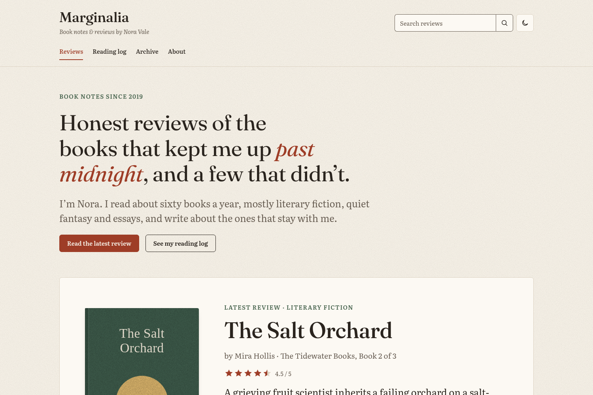

# Readerly

Readerly is a free Hugo theme for book blogs, author sites and reading logs.



- Review posts with a cover, star rating, book details and a verdict box.
- A reading log with yearly statistics and shelves for Reading, Read, Want to read and Did not finish.
- An author page for your own books, praise and upcoming events.
- Genre and tag pages, and a search box that runs in the visitor's browser.
- Two styles, Paper (light) and Lamplight (dark), that follow the visitor's system setting, with a toggle.
- Bundled fonts and no third-party requests.
- schema.org review data, Open Graph tags and an RSS feed.

Every part is optional. The theme creates no posts or pages, and a section with no data prints nothing, heading included.

Readerly needs Hugo 0.146.0 or later. The standard edition is enough.

## Install

### As a Hugo module (recommended)

You need Go installed. In your site's folder:

```sh
hugo mod init github.com/<you>/<your-site>
```

Add the theme to `hugo.toml`:

```toml
[module]
  [[module.imports]]
    path = "github.com/listofbooks-net/hugo-theme-readerly"
```

Run `hugo server`. To update the theme later, run `hugo mod get -u`.

### As a Git submodule

```sh
git submodule add https://github.com/listofbooks-net/hugo-theme-readerly.git themes/readerly
```

Then set `theme = "readerly"` in `hugo.toml`.

### Try the example site

```sh
git clone https://github.com/listofbooks-net/hugo-theme-readerly.git
cd hugo-theme-readerly/exampleSite
hugo server
```

The example site is Marginalia, a fictional book blog with ten reviews, a reading log and an author page. Copy any of its files into your own site as a starting point.

### Move an existing site to Readerly

Readerly reads what most Hugo sites already have: posts in a section such as `content/posts/`, `categories` and `tags`, the `main` menu, `params.author` and `copyright`. Existing posts render as articles. Add book keys to a post to turn it into a review.

## Write a review

A review is an ordinary post in one of your main sections (by default, the section with the most pages) with extra front matter. Every key except `title` is optional. Delete a key and the part it fills disappears. A post with none of the book keys renders as a plain article.

Run `hugo new content reviews/the-salt-orchard.md` to start from a template that lists every key.

```yaml
---
title: The Salt Orchard
date: 2026-11-04
lead: A novel about grief that keeps its accounts in apples.
book_author: Mira Hollis
cover: /assets/covers/salt-orchard.jpg
categories: [Literary fiction]
tags: [Historical, Tidewater series]
rating: 4.5
series: The Tidewater Books, Book 2 of 3
pages: 384
publication: 2026, Harrow & Lane
status: read
finished: 2026-10-30
summary: A grieving fruit scientist inherits a failing orchard on a salt-burned coast.
verdict:
  summary: Patient, precise and quietly devastating.
  liked: [The orchard as a living clock, Danny Aske]
  disliked: [A too-tidy answer to the ledger mystery]
---
The review, in Markdown.
```

### Book entry keys

Reviews and the rows of `data/reading_log.yaml` share these keys.

| Key | Type | What it does | When it is missing |
| --- | --- | --- | --- |
| `title` | text | The post headline, and the book title unless `book_title` is set. | Required. |
| `book_title` | text | The book's title, when the headline differs from it. | The title is `title`. |
| `book_author` | text | The book's author. `author` stays free for the person who wrote the post. | No "by" line. |
| `cover` | path or URL | A cover image, ideally 2:3. A post can name an image in its own page bundle. | A typeset cover with the title and author. |
| `rating` | number, 0 to 5 | Stars. Halves are allowed. | No stars anywhere, and no average rating. |
| `series` | text | Shown in the book panel and the featured card. | That row is left out. |
| `pages` | number | Page count. Counts toward "Pages read" and the progress bar. | That row is left out. |
| `publication` | text | Publication details, such as `2026, Harrow & Lane`. | That row is left out. |
| `status` | `reading`, `read`, `want` or `dnf` | Puts the book on a reading-log shelf and shows a badge. | On no shelf, and no badge. |
| `finished` | date | Orders the Read shelf and counts the book in that year's statistics. | Last on the Read shelf, and not in a year's statistics. |
| `current_page` | number | With `pages`, a progress bar for `reading` and "Stopped at page N" for `dnf`. | No progress bar. |
| `url` | path or URL | A link for a reading-log row. Posts have their own URL. | The card has no link. |

These keys apply to posts only:

| Key | What it does |
| --- | --- |
| `categories` | The book's genres. The first one labels the cards, fills "You might also like", and appears in the genre list. Each genre has its own page. |
| `tags` | More labels, shown as chips next to the genre. Each tag has its own page. |
| `lead` | A subtitle under the headline. |
| `summary` | The text on review cards. Without it, Hugo uses the start of the post. |
| `featured` | `true` puts the post in the large card on the home page. Without any featured post, the newest review fills it. |
| `verdict` | `summary`, `liked` and `disliked`, shown in a box after the review. |

If a post has `rating` and `book_author`, its page carries schema.org `Review` data for search engines.

## Keep a reading log

Create `content/reading-log.md`:

```yaml
---
title: Reading log
layout: reading-log
year: 2026
intro:
  eyebrow: Reading journal
  heading: What I'm reading in 2026
---
```

The log shows every review with a `status`, plus the rows of `data/reading_log.yaml`. A book you reviewed needs no row there. List the books you have not reviewed, with the same keys as a review:

```yaml
- title: Moth Season
  book_author: Pell Ordway
  status: reading
  pages: 368
  current_page: 142
- title: The Ninth Wave Hotel
  book_author: Bea Lindqvist
  status: want
```

`year` limits the statistics and the Read shelf to the books finished that year. Without `year`, they cover every book. Once the page exists, the "Currently reading" band on the home page links to it.

## Build an author page

Create a page with `layout: author` and fill three data files: `data/books.yaml` for your own books, `data/praise.yaml` for quotes, and `data/events.yaml` for readings and signings.

```yaml
---
title: Isobel Thorne
layout: author
hero:
  eyebrow: Novelist
  portrait: /img/isobel.jpg
  lead: I write novels about small towns and old trades.
  buttons:
    - { title: Discover The Bell Foundry, url: "#new-release" }
---
```

| File | Keys |
| --- | --- |
| `data/books.yaml` | `title`, `cover`, `year`, `kind`, `blurb`, `buy_url`, `url`. The first book with `featured: true` also fills the new-release band, which reads `label`, `lead`, `facts`, `url_label` and `where_to_buy` (a list). |
| `data/praise.yaml` | `quote`, `source`, `context`. The theme adds the quotation marks. |
| `data/events.yaml` | `title`, `date`, `where`, `url`, `label`. Events dated before the build are left out. |

## Choose and order sections

The home page and the `author` and `reading-log` layouts are lists of sections. To remove a section, reorder sections, or use one on another page, set `sections` in the page's front matter (for the home page, in `content/_index.md`):

```yaml
---
sections: [intro, recent-reviews, genres]
---
```

A misspelt name stops the build with an error that names it.

| Page | Default sections |
| --- | --- |
| Home page | `intro`, `content`, `featured-review`, `recent-reviews`, `currently-reading`, `genres`, `newsletter` |
| `layout: author` | `author-hero`, `new-release`, `books`, `praise`, `events`, `newsletter` |
| `layout: reading-log` | `intro-stats`, `currently-reading`, `shelves` |

Any page can use `layout: sections` with its own list. These are all the sections:

| Section | Shows | Page keys it reads |
| --- | --- | --- |
| `intro` | A heading with an eyebrow, lead and buttons. | `intro: {eyebrow, heading, lead, buttons}`. The heading and lead accept Markdown, so `*past midnight*` is set in italics. |
| `intro-stats` | `intro` with the reading statistics under it. | `intro`, `year` |
| `featured-review` | The newest featured review, else the newest review. | None |
| `recent-reviews` | A grid of reviews, paginated on the home page and other list pages. | None |
| `currently-reading` | Books with `status: reading`. | `currently-reading: {heading, note}` |
| `genres` | Each genre with its number of reviews. | `genres: {heading, note}` |
| `newsletter` | A sign-up form. | `newsletter`, which overrides any `params.readerly.newsletter` key |
| `author-hero` | The author's portrait and introduction. | `hero: {eyebrow, portrait, lead, text, buttons}` |
| `new-release` | The featured book from `data/books.yaml`. | None |
| `books` | Every book in `data/books.yaml`. | `books: {heading, note}` |
| `praise` | Quotes from `data/praise.yaml`. | `praise: {heading, note}` |
| `events` | Upcoming events from `data/events.yaml`. | `events: {heading, note}` |
| `shelves` | The Read, Want to read and Did not finish shelves. | `year`, and `shelves: {read, want, dnf}`, where each takes `{note}` or `false` to hide that shelf |
| `content` | The page's own Markdown. | None |

On page 2 and later of the home page, only `recent-reviews` shows.

## Archive, genres and search

The list page of your reviews' section (for example `/reviews/` or `/posts/`) is the archive. With several `mainSections`, the first one's list page is the archive and the search box searches it. It lists every review, newest first, and the search box in the header and on the 404 page searches it. Search runs in the visitor's browser, with no index file and no external service.

Each genre (`categories`) and tag has its own page, paginated. Genre and tag names appear as your posts write them (`Science fiction` stays `Science fiction`), without Hugo's automatic title case. To give a genre page a description, create `content/categories/<genre>/_index.md`:

```yaml
---
title: Literary fiction
eyebrow: Category
lead: Novels where not much happens and everything changes.
---
```

## Configure the site

Readerly reads the standard Hugo settings `title`, `copyright`, `pagination.pagerSize`, `menus.main` and `menus.footer`, plus a few keys under `params`. Every key is optional.

```toml
title = "Marginalia"
copyright = "All reviews are my own."

[pagination]
  pagerSize = 9

[[menus.main]]
  name = "Reviews"
  pageRef = "/"
  weight = 1
[[menus.main]]
  name = "Reading log"
  pageRef = "/reading-log"
  weight = 2

[[menus.footer]]
  name = "Browse"
  identifier = "browse"
[[menus.footer]]
  name = "About"
  pageRef = "/about"
  parent = "browse"

[params]
  description = "Honest book reviews."
  tagline = "Book notes & reviews by Nora Vale"
  [params.author]
    name = "Nora Vale"
    avatar = "/img/nora.jpg"
    bio = "Former school librarian who reads about sixty books a year."
    url = "/about/"
  [params.readerly]
    style = "auto"
    footerAbout = "Slow, honest reviews of novels, essays and poetry."
    [params.readerly.newsletter]
      action = "https://buttondown.com/api/emails/embed-subscribe/you"
      heading = "One email a month."
```

| Key | Default | What it does |
| --- | --- | --- |
| `menus.main` | none | Header links. |
| `menus.footer` | none | Footer link columns: each top-level entry is a column heading, and its children are the links. A top-level entry with no children is not shown. |
| `copyright` | none | Printed after "© year site title." in the footer. A value that contains © is printed on its own. |
| `params.description` | none | The meta description of pages that have none of their own. |
| `params.tagline` | none | The line under the site title. |
| `params.author` | none | A name, or `name`, `avatar`, `bio`, `url` and `links` (a list of `{title, url}`). With `name` and `bio`, each review ends with a bio card. A post's own `author` overrides the byline. |
| `params.readerly.style` | `auto` | `auto` follows the visitor's system setting. `paper` and `lamplight` fix one style. |
| `params.readerly.styleToggle` | `true` | Shows the light and dark button in the header. `false` also removes the theme's script from every page. |
| `params.readerly.newsletter` | none | `action` (the form's URL) turns the newsletter band on. Also `eyebrow`, `heading`, `note`, `button`, and `field` (the email field's name, default `email`). |
| `params.readerly.footerAbout` | none | A sentence under the site title in the footer. |
| `params.readerly.relatedPosts` | `3` | How many reviews "You might also like" shows. `0` turns it off. |
| `params.readerly.dateFormat` | `2 January 2006` | A [Go date layout](https://gohugo.io/functions/time/format/). Month names follow the site language. |
| `params.readerly.favicon` | none | The site icon. |
| `params.readerly.customCSS` | none | A stylesheet loaded after the theme's. |

Links in menus, front matter and data files may be paths on your site (`/about/`) or full URLs. Paths work when the site lives under a subpath, such as a GitHub Pages project site.

## Change colours and fonts

The theme's colours, fonts and spacing are CSS custom properties. To change them, add a stylesheet under `static/` and name it in `params.readerly.customCSS`:

```css
:root { --color-accent: #1d4ed8; }
```

The full list is at the top of `assets/readerly/css/readerly.css`.

## Translate the interface

Every interface string is in `i18n/en.yaml`. To change one, or to translate the theme, add the keys you want to `i18n/<language>.yaml` in your site:

```yaml
recent_reviews: Neueste Rezensionen
by: "von {{ .Name }}"
```

## Add comments or analytics

Readerly makes no third-party requests. To add a comment system or analytics, create one of these files in your site:

- `layouts/_partials/comments.html` is printed at the end of each review.
- `layouts/_partials/head-custom.html` is printed at the end of `<head>`.

## The footer credit

Each page ends with one link, "Theme by List of Books", to https://www.listofbooks.net/. Keeping it is how you thank us for the theme. To remove it, create an empty file at `layouts/_partials/credit.html` in your site.

## License

The theme is released under the MIT License. The bundled fonts, Fraunces and Literata, are under the SIL Open Font License 1.1, and each font folder holds its license text.

This repository is a read-only copy of the `hugo/theme` folder of [listofbooks-net/readerly-theme](https://github.com/listofbooks-net/readerly-theme), where the design and the WordPress and Jekyll versions also live. Open issues here or there. Send changes to the monorepo.
